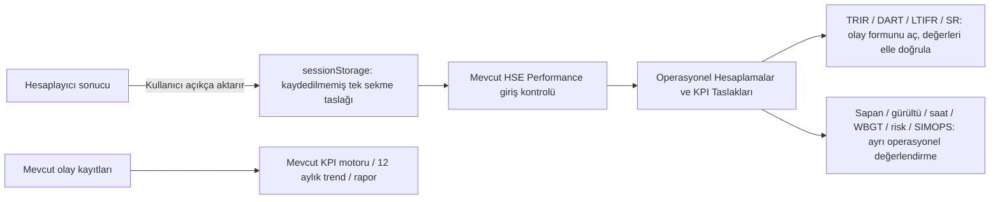

# HSE Calculator Hub — Issue #124

## Durum ve kapsam

Tek paket, tek dal: `codex/hse-calculators-hub-kpi-pack`. Başlangıç güncel main: **`063a93d36c10262a7103c73a56fd6b2f7a98af79`**. Değişiklikten önce `backup/hse-calculator-pack-main-20261022` yerel yedeği ve `/tmp/sernem-main-before-hse-calculator-pack.bundle` oluşturuldu; bundle tam geçmiş içerir ve `git bundle verify` geçti. Bundle SHA256 ve korunan **82 modülün** hashleri [baseline.json](baseline.json).

Main/production'a yazma, merge veya manuel dağıtım yok. SIM 5.0 PR #122 dalı değiştirilmedi. Ödeme, Premium/trial/üyelik, auth/session, Supabase şema/RLS/API/webhook, XP ve SIM kodu aynı. Çalışma, yalnız hesaplayıcılar/menü/arama ve KPI sunum-CTA alanlarıyla sınırlı; kaynak dosyası sayısı **26**. QA/rapor/örnekler dahil toplam değişiklik 40 dosyanın altında tutuldu.

**Karar: Draft incelemeye hazır; canlı yayın için onay verilmedi.** Yerel production build ve aşağıdaki testler geçer. Gerçek üye/Supabase rapor akışı ile güncel resmi belgelerin internetten içerik doğrulaması tamamlanamadı; bunlar başarılı sayılmaz. Özellikle NIOSH model kapsamı ve WBGT kıyafet düzeltmeleri yayın öncesi yetkin HSE kişi tarafından resmi referansların güncel sürümüyle incelenmeli.

## Envanter: mevcut işler tekrar oluşturulmadı

| Grup | Araç / korunan rota | Sonuç |
|---|---|---|
| Hesaplayıcı | `tools/risk-matrix` | Aynı 5×5 motor, başlangıç/kalan risk ve PDF; operasyonel taslak CTA |
| Hesaplayıcı | `tools/trir` | Aynı calculateTRIR, 200.000 saat; tam sayı ve sonlu sonuç koruması |
| Hesaplayıcı | `tools/ltifr` | Aynı calculateLTIFR, 1.000.000 saat; tam sayı ve sonlu sonuç koruması |
| Hesaplayıcı | `tools/severity-rate` | Aynı calculateSeverityRate, 200.000 saat; NaN/Infinity koruması |
| **Yeni** | `tools/dart` | Mevcut calculateDART, 200.000 saat; vaka, gün değil |
| **Yeni** | `tools/sling-tension` | Simetrik iki kollu statik sapan gerilimi |
| **Yeni** | `tools/noise-exposure` | Çok satırlı NIOSH doz / 8 saat normalize seviye |
| **Yeni** | `tools/man-hours` | Çok vardiya/alt yüklenici net saat toplamı |
| **Yeni** | `tools/heat-stress` | Ölçülen WBGT + kıyafet düzeltmesi; uydurma ölçüm yok |
| Planlama | `tools/simops` | Aynı planlayıcı/karar/matris/PDF/kayıt mantığı; seçili faaliyetlerin en yüksek başlangıç/kalan riski operasyonel taslak |
| Planlama | `tools/quick-risk-assessment` | HIRARC aynen; menüde açık metodoloji adı |
| Dokümantasyon | `tools/method-statement` | Aynı çıktı; Türkçe ana başlıklar düzeltildi |
| Dokümantasyon | `safety-pack`, `ppe-standards` | Aynı rotalar; Planlama ve Dokümantasyon grubunda |

`/tr/tools#calculators` ve `/en/tools#calculators` gerçek kategori hedefleri. DesktopMegaMenu ve MobileMainMenu aynı katalogdan dokuz hesaplayıcı + beş planlama kartı gösterir. ProductExplorer/LocalizedCategories hesaplayıcı CTA'ları doğru anchor'a gider. GlobalSearch beş yeni aracı TR/EN indeksler; arama girişine erişilebilir ad eklendi. Legacy rotalar kaldırılmadı/redirect edilmedi.

Yeni sayfalarda canonical, TR/EN ve x-default hreflang; kategori metadata'sı, görünür breadcrumb/dönüş/KPI bağlantıları ve sitemap kayıtları var. SIMOPS'un eksik sitemap kaydı da eklendi. Yeni araçlar için sahte LIVE rozeti yok. Ana sayfanın KPI grafiği zaten görünür **ÖRNEK VERİLER / ILLUSTRATIVE DATA** etiketi taşıyordu; yeniden yapılmadı.

## Teknik metodoloji ve örnekler

Hesaplar tam hassasiyetle; gösterim iki ondalık ve TR/EN sayı formatıyla yapılır. Yeni girdiler ondalık nokta/virgülü destekler; binlik ayırıcılar tahmin edilmez. Boş, negatif, sonlu olmayan veya kapsam dışı değerler sonuç üretmez. Vaka/çalışan sayıları güvenli tam sayıdır. Hatalı payda sıfır oran gibi gösterilmez.

| Araç | Formül / örnek | Sınır ve referans |
|---|---|---|
| TRIR / DART | `cases × 200000 / worked_hours`; 3 / 200000 → 3 | Aynı dönem/çalışan kapsamı, gerçek saatler. DART: gün kaybı + kısıtlı iş/görev değişimi vakaları; her vaka bir kez. [BLS incidence rates](https://www.bls.gov/iif/overview/compute-nonfatal-incidence-rates.htm) |
| LTIFR | `LTI × 1000000 / worked_hours`; 2 / 1000000 → 2 | Kayıp zamanlı yaralanma tanımı kuruma/yargıya göre doğrulanır; 200.000'e sessizce çevrilmedi |
| Şiddet Oranı | `lost_days × 200000 / worked_hours`; 12 / 200000 → 12 | SERNEM'in mevcut bazı korunur; farklı payda konvansiyonlarıyla aynı gibi kıyaslanamaz |
| Sapan | `T = W/(2 sin θ)`; θ **yataydan**. `1 kgf = 9.80665 N`; 1000 kg, 30° → kol başına 9,80665 kN = 1000 kgf | 0<θ≤90; <30° uyarı. Eşit paylaşımlı simetrik statik model; dinamik yük, CoG, WLL, hitch/bridle, D/d ve donanım ayrıca doğrulanır. Kapasite sertifikası/kaldırma planı değildir. [OSHA sling figures](https://www.osha.gov/safe-sling-use/tables-figures) |
| Gürültü | `T(L)=480×2^((85−L)/3)` dakika; `D=100Σ(C/T)`; `L8=85+10log10(D/100)`. 85 dBA×480 veya 88 dBA×240 → %100, 85 dBA | NIOSH 85 dBA/8 h, nominal 3-dB exchange; yerel yasal limit değil. Sürekli ses, 0–115 dBA; toplam >0–1440 dakika, eşik kesmesi yok. 0 dBA mutlak sessizlik değildir; sıfır süre doz eklemez, bütün süre sıfırsa sonuç yok. Kayıt dışı süre sıfır enerji varsayımı; 100+ dBA hızlı kontrol, >115/darbe gürültüsü uzman değerlendirmesi. 3 dB yuvarlaması nedeniyle dozdan logaritmik seviyeye dönüşte küçük farklar açıklanır. [NIOSH 98-126](https://www.cdc.gov/niosh/docs/98-126/pdfs/criteriadoc_98-126.pdf) |
| Adam-saat | `Σ[kişi × gün × (vardiya + fazla mesai − mola) − satır toplam devamsızlığı]`; 10×5×(8+1−0,5)−5 = 420 | Fazla mesai/mola kişi-gün başına, devamsızlık bütün satırın çalışan-saatidir; tekrar çarpılmaz. Günlük vardiya+mesai ≤24; fazla mola/devamsızlık geçersiz. Tahmini/gerçekleşen ayrı; kayıtlı kaza oranına otomatik aktarılmaz. BLS gerçek çalışma saati kavramı + açık aritmetik |
| WBGT | `adjusted = measured WBGT + clothing adjustment`; ölçülen 28 + çift kat 3 → 31 °C | Hava sıcaklığı/nemden WBGT üretilmez. Isı taraması ölçüm aralığı 0–60 °C; kıyafet 0 / çift kat dokuma +3 / sınırlı kullanımlı buhar geçirmez tulum +11. İş yükü/aklimatizasyon bağlamıyla su, serin mola, gözetim ve kademeli alışma önerileri. Otomatik “güvenli / çalışmaya devam / izin” eşiği yok. [OSHA hazards](https://www.osha.gov/heat-exposure/hazards), [OSHA OTM heat chapter](https://www.osha.gov/otm/section-3-health-hazards/chapter-4) |

**Kaynak erişim sınırı:** OSHA/NIOSH/BLS doğrudan sayfa/PDF istekleri normal ve yükseltilmiş denemelerde HTTP 403 verdi. Alternatif OSHA OTM/CDC Stacks/BLS erişimi de engellendi; son ek izin denemesi kullanıcı tarafından iptal edildi, tekrar bekletilmedi. Bu oturumda güncel belge içeriği indirilmiş/doğrulanmış gibi raporlanmaz. Matematik, boyut/birim tutarlılığı ve sınır örnekleri bağımsız golden testlerle doğrulandı; bu, resmi doküman revizyonunun veya mesleki saha onayının yerine geçmez. Linkler kurumsal kaynak hedefleridir; erişilebilirlikleri bu ortamdan onaylanamadı.

Sapan, gürültü ve WBGT sonuçları çalışma izni veya kesin güvenlik kararı değildir. Isı hastalığı bulgusunda acil yardım ve kurumsal acil planı gerekir. Kıyafet/iş yükü/aklimatizasyon ve yerel yasal/kurumsal eşikler yetkin kişiyle doğrulanmalıdır.

## Gerçek KPI entegrasyonu: verinin anlamı korunur



- **Sadece link değil:** Sonuç, birim, metodoloji, kaynak araç, zaman damgası, ölçülen/tahmini/gerçekleşen niteliği ve girdiler kullanıcı tıklamasıyla aynı sekmede taşınır. Gerçek HsePerformanceClient içinde ayrı panelde gösterilir; incidents formunda da inceleme paneli bulunur. Kaynak araca dönüş ve lagging göstergelerde mevcut olay formuna devam vardır.
- `sessionStorage` anahtarı `sernem.calculator-draft.v1`. Sayfa açılınca otomatik hesap sonucu yazılmaz; kullanıcı açık aktarım düğmesine basmalıdır. Taslak kalıcı kayıt değildir, tab yaşam döngüsüne bağlıdır ve temizlenebilir. Her yeni aktarım bu sekmenin önceki taslağını değiştirir. Kullanıcı hesabına kaydetme yok; kapalı/engelli depolamada hata gösterilir. Bozuk/uygunsuz kaynak-tür JSON'u kabul edilmez, metinler HTML olarak çalıştırılmaz.
- TRIR/DART/LTIFR/SR aynı `app/lib/hse-metrics` fonksiyonlarını kullanır. Yeni veri modeli/tablo/dashboard oluşturulmadı. Gerçek saatler ve olay sınıfları dönem/proje bazında kullanıcı tarafından kontrol edilmelidir. Otomatik form doldurma veya kaydetme **yok**; kullanıcı mevcut olay formunda ayrıca doğrular/kaydeder. DART vakası gün veya ikinci bir vaka gibi sayılmaz.
- Eski TRIR/LTIFR/SR hesaplayıcılarında doğrudan `.insert/.update` ile aylık saat/vaka üzerine yazma vardı. Bu yol kaldırılıp **kaydedilmemiş taslak inceleme** akışına çevrildi. Var olan veritabanı kayıtlarına dokunulmadı; üyelik veya giriş güvenliği değiştirilmedi. Hedef HSE Performance sayfasının mevcut giriş yönlendirmesi aynen çalışır.
- Operasyonel sonuçlar mevcut accident-rate tablolarına, trendlere veya raporlara katılmaz. Tahmini adam-saat gerçek `worked_hours` olarak yazılmaz. SIMOPS taslağı mevcut motorun seçili faaliyetlerdeki maksimum başlangıç/kalan riskini ve karar bağlamını taşır; kaza oranı değildir.
- KPI içinde hesaplayıcılara görünür dönüş/kısayol var. On iki aylık trend/veri sorguları ve `HseReportingPanel.tsx` değişmedi. Gerçek kullanıcı verisiyle birleştirme/kalıcı kaydetme gerekirse bu paketin dışındadır.

## TR/EN somut bulgu / düzeltme matrisi

| Bulgu | Düzeltme / koruma |
|---|---|
| Desktop tools listesi Severity/DART içermiyordu; mobilde DART yoktu | Ortak katalog; dokuz araç iki menüde aynı grupta |
| Planlama/hesaplayıcılar karışıktı | İki grup, ayrı başlık/kartlar ve gerçek `#calculators` hedefi |
| Yeni araçlar site aramasında/sitemap'te yoktu | TR/EN GlobalSearch + beş rota; SIMOPS sitemap eksikliği de düzeltildi |
| Türkçe TRIR H1 İngilizceydi | `TRIR Hesaplayıcı`; sonuç rozeti ve footer da yerelleştirildi |
| Method Statement TR ana başlıklar İngilizce teknik isimle sınırlıydı | Türkçe çalışma yöntemi oluşturucu/kütüphane başlıkları; çıktı motoru korunur |
| KPI H1 / KPI Dashboard / leading-lagging / aylık olay etiketleri İngilizceydi | Türkçe sunum başlıkları ve yardımcı etiketler; müşteri kategorileri/verileri yeniden yazılmaz |
| Incidents metni tüm oranları OSHA gibi tanımlıyordu | TRIR/DART 200k, LTIFR 1M, SR 200k açık; genel oran göstergesi başlıkları |
| TRIR/LTIFR ondalıklı vaka kabul ediyordu | Güvenli tam sayı doğrulaması; geçersiz hesap düğmesi kilitli |
| SR NaN kontrolü Infinity'yi dışlamıyordu; aşırı değer sonucu Infinity olabilirdi | Sonlu girdi/sonuç koruması; motor aynı |
| Hesaplayıcıdan doğrudan KPI insert/update | Yalnız kullanıcı tıklamasıyla sekmelik kaydedilmemiş taslak; otomatik kayıt yok |
| Otomatik renk/aralıkların genel standart gibi algılanma riski | Mevcut referans bantlarının evrensel OSHA limiti/güvenlik onayı olmadığı görünür açıklama; mevcut PDF kodu keyfi yeniden yazılmadı |
| Risk Matrix vs HIRARC olası metodoloji karışıklığı | Denetim: ikisi de 1–25 ve 4/9/16 sınırları; son etiket Extreme/Çok Yüksek vs Critical/Kritik. Matematik/raporlar birleştirilmedi |
| Yeni print stillerinin eski raporu etkileme riski | Stiller yalnız `[data-calculator]` içeren yeni sayfalarda; mevcut PDF fonksiyonları byte karşılaştırıldı |
| Ana sayfa KPI grafiği gerçek veri sanılabilir mi? | Mevcut görünür ILLUSTRATIVE DATA / ÖRNEK VERİLER etiketi doğrulandı, tekrar yapılmadı |

Bütün müşteri serbest metinleri/kategorileri çevrilmiş gibi iddia edilmez. Teknik kısaltmalar TRIR/DART/LTIFR/MTC/ISO/OSHA korunur. Mevcut premium rapor motorunda yeni çeviri/refactor yapılmadı; gerçek kullanıcı raporu indirme/izin testi yapılmadı.

## Testler ve kanıtlar

- **51 golden/koruma testi PASS:** dört KPI bazı, birimler, sapan açıları/taşma, NIOSH tek/çoklu seviyeler/0 süre/0 dBA/100+/115 sınırı, net saat/mesai/mola/devamsızlık/çok satır, ölçümsüz WBGT ve kıyafet düzeltmesi; 82 korunan hash; kalkülatörlerde doğrudan yazma yok. [unit-results.json](unit-results.json)
- **132 tarayıcı kontrolü PASS:** dokuz hesaplayıcı × TR/EN × 320/390/768/1440/1920; normal örnekler, yanlış girdi sonucu bastırma, metadata/canonical/hreflang, yatay taşma, desktop/mobile menü ve klavye/touch, ana sayfa menüsü/örnek KPI etiketi, arama, taslak->guest login yönlendirmesi ve aynı tüketici bileşeninde incele/temizle. [browser-results.json](browser-results.json)
- **Gerçek KPI bileşeni fixture: TR/EN PASS.** Aynı HsePerformanceClient + değişmeyen rapor bileşeni, sadece sentetik read-only client: 200000 saat, 2 recordable, 1 DART, 1 LTI, 12 gün → TRIR 2, DART 1, LTIFR 5, SR 12. Mobil taşma yok, yazma denemesi 0. Uygulamanın auth'u aşılmadı; test DOM'una bağımsız mount. Gerçek oturum/Supabase testi değildir. Kanıt `unit-results.json > kpiUI`.
- **14 PDF QA PASS:** beş yeni araç × TR/EN A4 print; mevcut TRIR/LTIFR × TR/EN gerçek indirme. Metin çıkarılabilir, NaN/Infinity yok, sayfa dışına taşan metin kutusu yok. Sayfa/boyut kontrolleri `browser-results.json > pdfChecks`. İki örnek: [TR WBGT](sample-tr-wbgt.pdf), [EN DART](sample-en-dart.pdf). Diğer QA PDF'leri `/tmp/hse-hub-*.pdf`.
- Yeni çıktıların SVG açı diyagramı/units/metodoloji/sınırları; font Türkçe karakterleri ve A4 metin yerleşimi kontrol edildi. Mevcut TRIR/LTIFR PDF fonksiyon gövdeleri TypeScript AST üzerinden baseline ile **byte aynı**; KPI rapor bileşeni hash aynı. Yeni premium export veya ödeme kapısı yok. Severity mevcut rapor/kopyalama akışı korunur; ayrı yeni Severity PDF motoru oluşturulmadı.
- **TypeScript ve normal build PASS.** Build'in prebuild PDF polish/PDF QA/download-auth QA adımları atlanmadı. Bunlar gerçek Supabase/ödeme testleri değildir. Build-generated 280 PDF değişikliği geri alındı ve PR'a alınmadı. Build özeti `browser-results.json > verification`.
- **ESLint dürüst sonucu:** seçili değişen dosyalarda eski main **4 hata/11 uyarı**, yeni sürüm **4 hata/11 uyarı**; **yeni bulgu 0**. Eski hook-effect hataları incidents/Simops içinde değişmeyen kodda. Yeni hesaplayıcı/helperlarda lint hatası yok. Bunlar düzeltildi veya tüm lint PASS diye raporlanmaz. Tam repo lint tekrar çalıştırılmadı; mevcut yaklaşık 183 hata/114 uyarı kapsam dışı.
- İlk development denemesi CSP/eval yüzünden etkileşim kanıtı sayılmadı; güvenlik config'i gevşetilmedi, normal production build kullanıldı. Menü testinin ilk yanlış hedefi ve 1280 varsayımı düzeltildi: mevcut responsive CSS gerçek desktop menüsünü **1536 px** üstünde açar. Son test 1440 ve 1920'yi ayrı doğrular.
- Local testler yalnız localhost, sentetik publishable değer ve forward etmeyen read-only fixture ile. Tarayıcıdan yetkisiz yazma isteği **0**; canlı auth/ödeme/analytics istekleri engellendi. Gerçek müşteri, Supabase verisi, abonelik veya XP kaydı kullanılmadı.

### Önce / sonra gerçek görüntüler

Kaynak: baseline commit'in ayrı **detached** yerel checkout'u (yeni geliştirme dalı değil); gerçek Next sayfası. Bu checkpoint yalnız görsel SSR kategori kıyasıdır, eski development JS etkileşim testi olarak sunulmaz.

| | Önce | Sonra |
|---|---|---|
| TR 390 px | [before-tr.png](before-tr.png) | [after-tr.png](after-tr.png) |
| EN 1440 px | [before-en.png](before-en.png) | [after-en.png](after-en.png) |

## Preview / PR

Son uygulama kaynak SHA **`ac6f5deb3b1b498ce0576e80551e77ff814b753e`** için GitHub deployment **7246576724 READY**:

- [TR Calculator Hub](https://safebase-17tq6s0h0-safebaseapps-projects.vercel.app/tr/tools#calculators)
- [EN Calculator Hub](https://safebase-17tq6s0h0-safebaseapps-projects.vercel.app/en/tools#calculators)

Normal ve yükseltilmiş ağ denemesinde 12 Preview rotası proxy `ERR_TUNNEL_CONNECTION_FAILED` ile erişilemedi. **READY API doğrulaması PASS; Preview tarayıcı E2E NOT VERIFIED.** Yerel production 132 testi buna karıştırılmaz. [preview-results.json](preview-results.json). Yukarıdaki değişmez Preview URL son uygulama commit’ine aittir; sonraki kanıt commit’i yalnız QA/rapor dosyalarını içerir.

## Tekrar üretim

```sh
node tools/hse-calculator-pack/check.mjs
node tools/hse-calculator-pack/check.mjs --kpi
node tools/hse-calculator-pack/browser.mjs
node tools/hse-calculator-pack/check.mjs --preview
cd app
npx tsc --noEmit
npm run build
```

Test harness default localhost 4188 normal build, baseline görsel sunucu 4190 ve mevcut read-only fixture 54512 kullanır. Dummy Supabase değişkenleri yalnız test sürecine verilir; `.env`/Vercel config yazılmaz. Build font ağı ilk denemede başarısız oldu, yükseltilmiş tekrar ve son normal build geçti. Test dışına veri gönderilmez. `check --kpi` gerçek authenticated ekran/sunucu akışını test ettiği anlamına gelmez.

## Açık sınırlar / yayın öncesi

1. Güncel resmi OSHA/NIOSH/BLS belge içeriklerine erişip model kapsamı, 3-dB yuvarlama ve kıyafet tablosunu mesleki gözden geçirme ile teyit edin.
2. READY Preview'ı gerçek tarayıcıda TR/EN kontrol edin; bu ortamın proxy engeli nedeniyle burada doğrulanamadı.
3. Ayrı sandbox kimlikleri sağlanmadan gerçek üye KPI/rapor/izin akışı **NOT TESTED**; canlı müşteriyle test yapılmaz. Bu paket şema, yetki veya auth düzeltmesi gerektirmez; ek kalıcı entegrasyon için ayrı yetki gerekir.
4. Mevcut bağımsız ESLint hataları sürer. Gerçek cihaz/baskı sürücüsü ve kurumsal saha standardı doğrulaması bütün Chrome headless testlerinden ayrı tutulur.

Merge veya production dağıtımı yapılmaz; kullanıcı incelemesi/onayı beklenir.

## English summary

One branch and one Draft PR deliver a nine-calculator hub with separate planning/documentation groups. Five independent public routes share reusable UI; DART reuses the existing engine. Canonicals, hreflang, sitemap, global search, desktop/mobile menus and calculator/KPI navigation are integrated. Existing formulas, 12-month KPI trends, reporting implementation, auth and all protected systems remain intact.

User-triggered tab-session drafts carry actual results, units, method, inputs, basis and timestamp into a separate KPI review panel. Operational assessments never become injury cases; estimates never become actual hours. The three old rate-calculator direct database writes are replaced with unsaved review, preserving existing data. Manual verified entry through the existing incident form remains a separate user action.

51 unit/protection checks, 132 browser checks, two real KPI-component read-only fixtures and 14 PDF checks pass. Normal build/TypeScript pass; selected-file lint retains four existing errors and eleven warnings, with zero new findings. The official sites returned 403 and Preview browser access failed through the proxy even after escalation, so current-source verification and remote E2E are not claimed. READY deployment is independently confirmed. No merge, production deploy or live customer tests occurred.

## Değişen uygulama dosyaları

- `app/app/[locale]/components/DesktopMegaMenu.tsx`
- `app/app/[locale]/components/GlobalSearch.tsx`
- `app/app/[locale]/components/LocalizedCategories.tsx`
- `app/app/[locale]/components/MobileMainMenu.tsx`
- `app/app/[locale]/components/ProductExplorer.tsx`
- `app/app/[locale]/hse-performance/HsePerformanceClient.tsx`
- `app/app/[locale]/hse-performance/incidents/page.tsx`
- `app/app/[locale]/tools/_shared/CalculatorHandoff.tsx`
- `app/app/[locale]/tools/_shared/NewCalculator.tsx`
- `app/app/[locale]/tools/_shared/catalog.ts`
- `app/app/[locale]/tools/_shared/math.ts`
- `app/app/[locale]/tools/_shared/page.tsx`
- `app/app/[locale]/tools/dart/page.tsx`
- `app/app/[locale]/tools/heat-stress/page.tsx`
- `app/app/[locale]/tools/layout.tsx`
- `app/app/[locale]/tools/man-hours/page.tsx`
- `app/app/[locale]/tools/method-statement/page.tsx`
- `app/app/[locale]/tools/noise-exposure/page.tsx`
- `app/app/[locale]/tools/page.tsx`
- `app/app/[locale]/tools/sling-tension/page.tsx`
- `app/app/components/RiskMatrix.tsx`
- `app/app/components/SimopsPlanner.tsx`
- `app/app/sitemap.ts`
- `app/app/tools/ltifr/page.tsx`
- `app/app/tools/severity-rate/page.tsx`
- `app/app/tools/trir/page.tsx`

QA: `tools/hse-calculator-pack/check.mjs`, `browser.mjs`; kalan dosyalar bu dizindeki rapor/ölçüm/hash/görsel/PDF kanıtlarıdır.

Son görsel PDF incelemesinde yeni sayfaların altındaki koyu dış arka plan tespit edilip yalnız yeni hesaplayıcıların print kapsamı içinde beyazlaştırıldı; 14 PDF kontrolü ve 132 tarayıcı kontrolü tekrar geçti. Eski PDF motorları değiştirilmedi.
