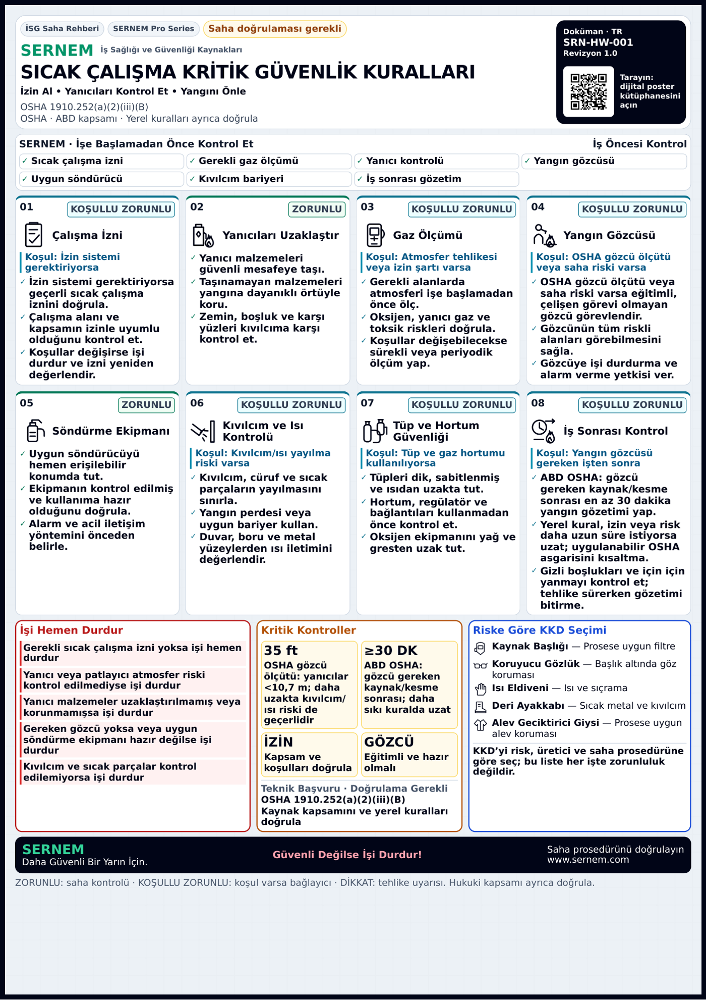
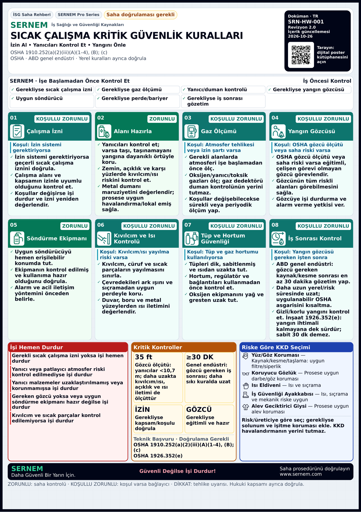

> **Son QR düzeltmesi:** [QR-FIX.md](QR-FIX.md) / talimat 6419563430, bu tarihsel rapordaki QR hedef ve ölçülerini günceller. Yeni kanonik adresler `https://www.sernem.com/{locale}/posters`; yeni PDF kanıtları `qr-fix/` altındadır.

# Paket 13 — Toplu renk ve teknik kalite kabulü

**Aynı Draft PR #126 / `codex/sernem-p13-hse-poster-quality`.** Başlangıç `4186391a31ae4fbcb455df56f1b4aa16d9526a8d`. Birlikte uygulanan talimatlar: [renk/tasarım #6416069898](https://github.com/safebaseapp/safebase/pull/126#issuecomment-6416069898) ve [teknik eksikler #6416174058](https://github.com/safebaseapp/safebase/pull/126#issuecomment-6416174058). Yeni dal/PR yok; main/production ve diğer PR'lar değiştirilmedi.

**Yazılım/PDF inceleme kapısı GO; production NO-GO.** Güncel resmî kaynak metni ve bağımsız yetkin HSE/yerel uygulanabilirlik kabulü doğrulanamadı; sahibin yayın onayı yok. Bu revizyon uzman onayı, sertifika veya mevzuat uygunluğu belgesi değildir. Fiziksel A4/A3 baskı, gerçek Premium/storage ve hosted Preview E2E NOT TESTED. Son SHA/Preview READY kanıtı aynı PR takip yorumunda ayrıca kayıtlıdır; READY uzaktan E2E değildir.

## Kısa bulgu/kabul matrisi

| Bulgu | Uygulama | Durum |
|---|---|---|
| Okunaklı sürümde renk yalnız ince çerçeveye düşmüştü | 8 kartta dolu başlık bandı + çok açık yüzey; zorunlu yeşil, koşullu teal, uyarı turuncu, bilgi mavi | PASS |
| Alt panellerin görsel kimliği zayıftı | Kırmızı durdurma, amber kritik kontrol, koyu mavi KKD bandı; açık yüzey ve koyu gövde metni | PASS |
| Renk tek başına anlam taşıyabilirdi | Metin rozetleri, kart numaraları ve görünür koşullar korundu; gri tonlama kanıtı eklendi | PASS |
| Sıcak çalışma atfı yalnız `(B)` idi | `1910.252(a)(2)(iii)(A)(1–4), (B); (c)` ve ayrı `1926.352(e)` bağlantısı görünür | PASS — bağımsız güncel kaynak doğrulaması değil |
| Genel endüstri/inşaat süreleri karışabilirdi | Genel endüstride gözcü gereken **kaynak/kesme** sonrası en az 30 dakika; inşaatta yangın ihtimali kalmayana dek gözetim, sabit 30 dk hükmü olmadığı ayrı belirtilir | PASS — uzman kabulü bekler |
| 35ft tek güvenli sınır gibi okunabilirdi | Daha uzakta kıvılcım/ısı, açıklıklar ve ısı iletimi de ölçüt olarak görünür | PASS |
| Gaz ölçümü metal dumanı kontrolünü kapsamıyordu | Aynı 8 kart içinde maruziyet değerlendirmesi, prosese uygun havalandırma/lokal emiş; gaz dedektörünün duman kontrolü yerine geçmediği açık | PASS |
| Ark ışını/sıçrama ve KKD seçimi | Çevredekiler için uygun perde; prosese uygun yüz/göz filtresi/siperlik, güvenlik ayakkabısı; gerektiğinde solunum/işitme koruması | PASS |
| Üst özet koşullu kartlarla tutarsızdı | İzin, gaz testi, gözcü, bariyer ve iş sonrası gözetimde “gerekliyse / where required”; yanıcı varsa kaldır/koru | PASS |
| Revizyon 1.0 güncel içeriği izlemiyordu | 15 kodda revizyon 2.0 ve gerçek içerik güncellemesi 2026-10-26; tarih bölünmeden basılır | PASS |
| A4/A3 ve logolu baskı riski | Standart 60 + sentetik şirket logolu 60 gerçek PDF; font, sayfa, QR ve metin kontrolleri | PASS |
| Resmî metin/uzman kabulü, fiziksel baskı, gerçek müşteri servisi | Yapılmadı/doğrulanamadı | NOT VERIFIED / NOT TESTED — production NO-GO |

## Tasarım ve teknik kapsam

Büyük gövde/teknik puntolar korunur; ikon alanı büyütülmedi, dokuzuncu kart açılmadı. Bandın rengi dışında önceki düzeltilmiş 120 SVG geometrisi değişmedi. 74 zorunlu / 42 koşullu / 4 uyarı sınıflandırması korundu; yalnız bilgi niteliğinde kart bulunmadığından bilgi kartı yok, mavi tema desteği hazırdır. Zorunlu etiketi hukuki onay anlamına gelmez; görünür açıklama ve koşullar devam eder.

Duman kontrolü “Alanı Hazırla / Prepare the Work Area” kartında zorunlu saha kontrolü olarak yer alır; atmosfer testi koşuluna bağlanıp gözden kaybolmaz. Gaz dedektörü ayrı 3. kartta kalır. Kaynak/kesme/taşlama için filtre/siperlik seçimi yapılır; kaynak başlığı bütün sıcak işlere tek evrensel KKD gibi gösterilmez. Deri malzeme sertifika değildir; “iş güvenliği ayakkabısı” riskle seçilir. Hiçbir EN edisyonu, sahte ürün onayı veya uzman adı üretilmedi. Beş durdurma maddesi, beş KKD satırı, sekiz kart ve önceki ankraj/nümerik/kapsam kontrolleri korunur.

`publication.ts`, bilinen 15 poster kodunun **editoryal** revizyon/güncelleme kaydını sağlar; tanımsız kodda sahte güncelleme tarihi göstermez. Poster verisindeki revizyonla eşitliği test edilir. Güncelleme tarihi mevzuatın bağımsız doğrulama tarihi değildir; `not-verified-in-session` ve saha doğrulama rozeti korunur. Git geçmişi ve bu rapor değişiklik kapsamını izler.

### QR kararı

QR mevcut `https://sernem.com/{tr,en}/posters` **dijital poster kütüphanesini** açar; poster slug'ına doğrudan gitmez. Başlıktaki tarama açıklaması bunu doğru söyler. Doğrudan bağlantı değerlendirildi fakat bu revizyonda mevcut ortak QR varlıkları/adresleri değiştirilmedi; poster bazlı yeni QR seti ve sürüm geçişi yapılmadı. Bu isteğe bağlı ürün tercihi bir güvenlik kabulü veya bu revizyonun zorunlu eksiği gibi sunulmaz. Bütün 120 standart/logolu PDF'nin QR'ı rasterden çözüldü; fiziksel telefon kamerası NOT TESTED.

## Ölçümler ve görsel kanıt

- TR sıcak çalışma A4 doygun alanı **%1.89 → %10.70**. Tüm 60 çıktıda renk alanı arttı; renk tek kabul ölçütü yapılmadı.
- 30 TR/EN rotada en düşük metin kontrastı **4.73:1**; bütün metinler için muhafazakâr 4,5:1, anlam taşıyan ikon çizgileri için 3:1 kapısı PASS. Bu bir WCAG sertifikası değildir.
- A4 gerçek gövde minimum **8,294pt**, kritik metin **7,806pt**, en küçük metadata **6,342pt**; A3 **11,730 / 11,040 / 8,970pt**. Standart ve logolu **120 PDF'nin tamamı tek sayfa**, hiçbir yazdırılabilir karakter 6pt altında değil; şeffaf/görünmez text trace yok.
- Başlangıçtaki okunaklı sürümle font alt sınırları aynı; eski 22ea örneğindeki %87,99 <6pt sorunu geri gelmedi. Yeni histogramın ana önce/sonra karşılaştırması **4186391a** sürümüdür.


- [60 PDF önce/sonra görsel ve ölçüm indeksi](final-revision/EVIDENCE-INDEX.md): **15 × TR/EN × A4/A3**, her birinin önce ve sonra gerçek PDF rasteri.
- [60 font dağılımı tablosu](final-revision/FONT-MEASUREMENTS.md), [standart PDF fontları](final-revision/after-fonts.json), [60 logolu PDF fontları](final-revision/branded-fonts.json).
- [Renk oranları](final-revision/color-results.json), [30 rota kontrastı](final-revision/contrast-results.json), [histogram](final-revision/font-histograms.png).

| TR sıcak çalışma A4 — önceki okunaklı sürüm | Sonra — renk + teknik revizyon |
|---|---|
|  |  |

[Gri tonlama TR A4](final-revision/grayscale-tr-hot-work-safety-rules-a4.webp) · [Gri tonlama EN A3](final-revision/grayscale-en-hot-work-safety-rules-a3.webp).

Renk ölçümü PyMuPDF gerçek 170dpi rasterinde, aynı HSV eşikleriyle yapılır; saklanan görseller lossless WebP'dir. Kullanıcının özel PDF'leri bu görevde dosya olarak verilmediğinden %11,24/%1,73 veya %11,06/%2,27 sayımlarını aynı dosyada yeniden ürettik denmez. Önceki repo commit'inin dosyaları hash'leriyle karşılaştırılır. Renk oranı tek kalite kriteri değildir: font, kontrast, metinsel sınıflandırma, geometri ve QR birlikte değerlendirilir.

## Son test sonuçları

| Kontrol | Sonuç | Kanıt |
|---|---|---|
| content-results | 36 PASS / 0 FAIL | [content-results.json](final-revision/content-results.json) |
| browser-results | 181 PASS / 0 FAIL | [browser-results.json](final-revision/browser-results.json) |
| after-fonts | 60 PASS / 0 FAIL | [after-fonts.json](final-revision/after-fonts.json) |
| mandatory-content-results | 32 PASS / 0 FAIL | [mandatory-content-results.json](final-revision/mandatory-content-results.json) |
| pdf-results | 60 PASS / 0 FAIL | [pdf-results.json](final-revision/pdf-results.json) |
| contrast-results | 30 PASS / 0 FAIL | [contrast-results.json](final-revision/contrast-results.json) |
| actions-results | 13 PASS / 0 FAIL | [actions-results.json](final-revision/actions-results.json) |
| branded-layout-results | 30 PASS / 0 FAIL | [branded-layout-results.json](final-revision/branded-layout-results.json) |
| branded-fonts | 60 PASS / 0 FAIL | [branded-fonts.json](final-revision/branded-fonts.json) |
| branded-pdf-results | 60 PASS / 0 FAIL | [branded-pdf-results.json](final-revision/branded-pdf-results.json) |
| color-results | 60 PASS / 0 FAIL | [color-results.json](final-revision/color-results.json) |
| TypeScript `npx tsc --noEmit` | PASS | Normal build TypeScript adımı da başarılı |
| Değişen TS/TSX ESLint | PASS: 0 hata, 2 mevcut img uyarısı | content-results.json |
| Normal `npm run build`, prebuild dahil | PASS | [build.log](final-revision/build.log); toolbox PDF + download-flow QA çalıştı |
| İkon geometrisi / koruma | 120 SVG aynı / 80 dosya hash aynı | [verification.json](final-revision/verification.json) |
| Fiziksel yazıcı/telefon, gerçek Premium/storage, hosted E2E, bağımsız güncel resmî kaynak | NOT TESTED / NOT VERIFIED | Production NO-GO |

Mobil kontroller Chromium 320/360/390/1440 viewport emülasyonudur; gerçek iOS/Android/Safari cihaz testi değildir.


Test iyileştirmesi bir uygulama hatasını gizlemez: önceki logolu Master fixture'ı gerçek rotadaki `sernem-poster-header` print override'ını içermediği için genel CSS başlığı gizliyordu; eski fixture PASS'i bu kabulde kullanılmaz. Yeni fixture **başlık görünürlüğünü**, doğru `html lang` ile TR `İ/ı` büyük harf dönüşümünü, fontların gerçekten yüklenmesini ve logo/QR sınırlarını zorunlu kontrol eder; ayrıca 60 logolu PDF'nin gerçek başlığı, revizyonu, kesintisiz tarihi, fontu ve QR'ı bağımsız kontrol edilir. Gerçek Premium yetkilendirme kodu değiştirilmedi; hesap/depolama sentetiktir.

Ara taşma FAIL'leri font küçültmeyle geçilmedi: teknik anlamı koruyan kısa anlatım ve boşluk düzenlemesi sonrası tüm matris yeniden üretildi. Eşikler gevşetilmedi; görünmez PDF text trace modu ve opaklık kontrolü de eklendi. Son kanıtlar final kaynak hash manifestiyle eşleşir. İki housekeeping PDF başlığında `pdftotext -layout`, sağ sütundaki tarihi başlık satırları arasına soktuğu için yanlış FAIL verdi; başlığın tamamı `-raw` okuma sırasında aynen aranarak kontrol düzeltilip tüm 60 PDF tekrar çalıştırıldı. Ayrı bbox/kırpılma ve punto eşikleri korundu.

## Koruma, kalan engeller ve teslim

80 korunan Auth/ödeme/Premium yetkilendirme/Supabase/SIM/XP/provider dosyasının SHA256 değeri aynı. Kaynak listesi ve kanıtlar [verification.json](final-revision/verification.json) içinde. Poster sayfası print geometrisi, toolbar ve branding canvas değişmedi. Yeni API, migration/RLS, üyelik/ödeme işlemi, gerçek veri yazımı veya deployment ayarı yok. Test istekleri yerel GET ile sınırlı; fixture aktivite kayıtları belleğe yazıldı. #122 ve diğer paketlerden kod taşınmadı.

Güncel resmi OSHA kaynakları bağımsız alınmış/doğrulanmış sayılmıyor. Önceki ağ tüneli 403 kanıtı [source-access.json](acceptance/source-access.json) içinde; önceki Preview HTTP denemesi de 403 ile engellendi ve genişletilmiş erişim denemesi kullanıcı tarafından iptal edildi. Bu nedenle hosted E2E veya güncel mevzuat PASS yazılmadı. Son Preview durumu yalnız GitHub/Vercel exact-SHA deployment kaydıyla bildirilir. Yayın kararı bağımsız teknik/yerel kabul ve sahibin açık onayına kadar **NO-GO**; PR Draft, merge/production deploy yok.

### Yeniden üretim

Mevcut normal production build'i yerel `4229` portunda çalıştırarak repo kökünden:

```sh
P13_EVIDENCE_DIR=docs/p13-review/final-revision node tools/p13-review/readability-audit.mjs
P13_EVIDENCE_DIR=docs/p13-review/final-revision node tools/p13-review/content.mjs
P13_URL=http://127.0.0.1:4229 P13_PDF_DIR=/tmp/p13-final P13_EVIDENCE_DIR=docs/p13-review/final-revision node tools/p13-review/readability-browser.mjs
python3 tools/p13-review/measure-fonts.py /tmp/p13-final docs/p13-review/final-revision/after-fonts.json
P13_PDF_DIR=/tmp/p13-final P13_EVIDENCE_DIR=docs/p13-review/final-revision node tools/p13-review/acceptance.mjs
P13_PDF_DIR=/tmp/p13-final P13_EVIDENCE_DIR=docs/p13-review/final-revision P13_SKIP_PREVIEWS=1 python3 tools/p13-review/pdf.py
P13_URL=http://127.0.0.1:4229 P13_EVIDENCE_DIR=docs/p13-review/final-revision node tools/p13-review/color-contrast.mjs
P13_URL=http://127.0.0.1:4229 P13_EVIDENCE_DIR=docs/p13-review/final-revision node tools/p13-review/branded-layout.mjs
python3 tools/p13-review/measure-fonts.py /tmp/p13-final-branded docs/p13-review/final-revision/branded-fonts.json
python3 tools/p13-review/branded-pdf.py
P13_URL=http://127.0.0.1:4229 P13_EVIDENCE_DIR=docs/p13-review/final-revision node tools/p13-review/actions.mjs
python3 tools/p13-review/color-metrics.py
P13_EVIDENCE_DIR=docs/p13-review/final-revision python3 tools/p13-review/font-report.py
python3 tools/p13-review/final-evidence-index.py
```

Önceki commit'e ait 60 PDF `/tmp/p13-colour-before`, standart son PDF'ler `/tmp/p13-final`, logolu PDF'ler `/tmp/p13-final-branded` altındadır. `/tmp` yeni oturumda mevcut varsayılmaz; baseline hash'leri doğrulanarak önceki build'den tekrar üretilebilir. Chromium/Playwright, PyMuPDF, Poppler/zbar, matplotlib/numpy gerektirir. `P13_SKIP_PREVIEWS=1` yalnız aynı rasterlerin ikinci kez önizleme dosyasına yazılmasını atlar; 60 PDF'nin QR/metin/sınır kontrolünü atlamaz.

### İndirilebilir son PDF örnekleri

[TR sıcak çalışma A4](final-revision/sample-tr-hot-work-a4.pdf) · [EN sıcak çalışma A3](final-revision/sample-en-hot-work-a3.pdf) · [TR housekeeping A4](final-revision/sample-tr-housekeeping-a4.pdf) · [EN yüksekte çalışma A3](final-revision/sample-en-height-a3.pdf).

Sentetik şirket logolu: [TR sıcak çalışma A4](final-revision/sample-branded-tr-hot-work-a4.pdf) · [EN sıcak çalışma A3](final-revision/sample-branded-en-hot-work-a3.pdf) · [TR yüksekte çalışma A4](final-revision/sample-branded-tr-height-a4.pdf) · [EN housekeeping A3](final-revision/sample-branded-en-housekeeping-a3.pdf). Gerçek şirket logosu veya müşteri verisi kullanılmadı.
