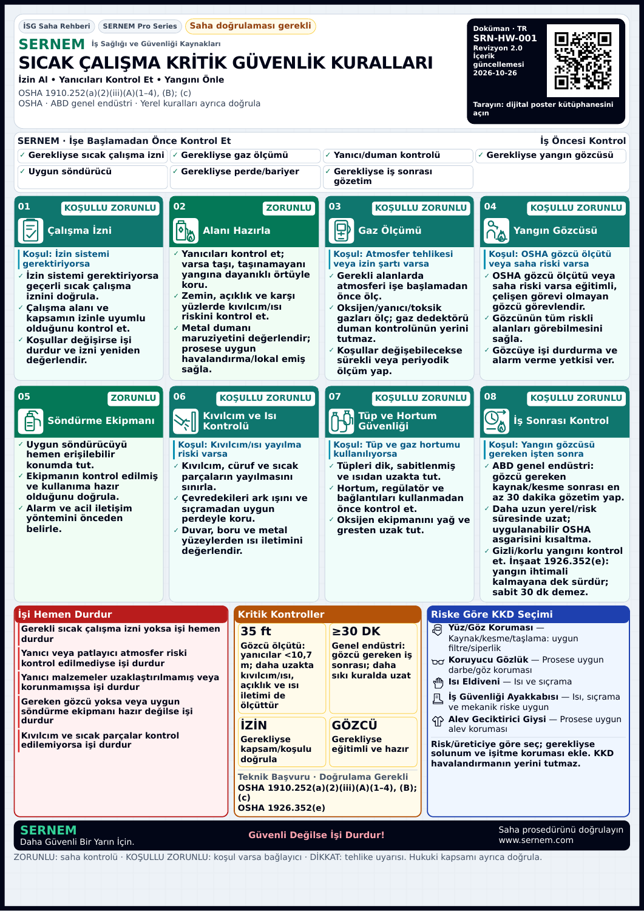

# Paket 13 — Kanonik www QR düzeltmesi

Aynı Draft PR #126 / `codex/sernem-p13-hse-poster-quality`. Talimat: [6419563430](https://github.com/safebaseapp/safebase/pull/126#issuecomment-6419563430). Başlangıç SHA `66643a24a5da9b2ba4c6dbd7a8787f7c9fd47781`.

**QR dosyaları ve yerel PDF kalite kapısı PASS. Production NO-GO.** Canlı www sayfaları ve apex→www yönlendirmesi bu ortamın ağ tünelinde engellendi; erişim/anonim kütüphane davranışı doğrulanmış sayılmaz. Bağımsız teknik/yerel kabul ve sahibin yayın onayı da açık. Fiziksel yazıcı/telefon kamerası ve gerçek Premium/storage NOT TESTED. Son SHA ve exact-SHA Preview durumu aynı PR takip yorumunda kayıtlıdır; READY hosted E2E değildir.

## Gerçek düzeltme

Önceki PNG'ler `https://sernem.com/{locale}/posters` kodluyordu. Şimdi tek kaynak [qr-targets.json](../../app/lib/posters-v2/qr-targets.json):

- TR: **https://www.sernem.com/tr/posters**
- EN: **https://www.sernem.com/en/posters**

15 posterin tamamı dile göre aynı iki ortak QR'ı kullanır. Poster slug'ı veya UTM eklenmedi. Başlığın “dijital poster kütüphanesini açın” açıklaması doğru kalır. Yeni encoder çıktısı iki PNG + iki SVG'dir; resim üretim modeli kullanılmadı. Encoder ReportLab gerçek QRCode, hata düzeltme M, 29×29 modül, dört modüllük beyaz quiet zone, 24 piksel/modül, **888×888 PNG**. Kaynakta yalnız saf siyah/beyaz; kontrast **21:1**. SVG aynı gerçek modül matrisinden oluşturulur. Bağımsız Zbar decoder, hem kaynak PNG'leri hem Chromium'da gerçekten rasterize edilen SVG'leri tam URL eşitliğiyle çözdü: **4/4 PASS**. [Asset ölçüleri/hash'leri](qr-fix/assets.json), [decode kanıtı](qr-fix/asset-decoding.json).

PNG yolları mevcut ortak yollar olarak korunur; Header `?v=www-v2` asset sürüm anahtarını ekler, eski görselin aynı cache URL'sinden gelmesi önlenir. **Bu query QR payload'ında yoktur.** Page route/print geometrisi değiştirilmedi. Header yalnız QR alanı için düzenlendi: metadata solda, büyüyen QR sağda, aynı açıklama aşağıda. Mevcut font boyutları, renkler, kartlar, ikon çizimleri, teknik metinler ve durdurma kriterleri değişmedi.

## Gerçek PDF ölçüleri ve düşük örnekleme

| Çıktı | Beyaz quiet zone dahil kare | Siyah modül matrisi |
|---|---:|---:|
| A4 | yaklaşık **23,41 mm** | yaklaşık **18,35 mm** |
| A3 | yaklaşık **33,10 mm** | yaklaşık **25,95 mm** |

Bunlar PDF görüntü dönüşüm matrisinden ölçülür; fiziksel cetvel/yazıcı ölçümü değildir. Dört modüllük quiet zone PNG'nin kendisindedir; eski yuvarlak kırpma kaldırıldı. Büyük QR için yazılar küçültülmedi, içerik gizlenmedi, sayfa sayısı artırılmadı.

**120 gerçek PDF × iki tam sayfa raster = 240 bağımsız QR çözümü PASS:** 15 poster × TR/EN × A4/A3 × standart/sentetik şirket logolu. Her sayfa **170 DPI ve 100 DPI** olarak rasterize edilip aynı Zbar decoder ile çözüldü. Kırpma, yakınlaştırma, yeniden deneme, filtre/threshold gevşetmesi yok. Her çözüm tam kanonik URL ile eşleşir. Tüm 120 QR'ın ölçülen siyah çekirdeği ≥18mm, kare ve tekil. [Tam dosya/DPI/hedef/ölçü/hash matrisi](qr-fix/qr-pdf-results.json).

A4 gövde **8,294pt**, kritik metin **7,806pt**, metadata minimum **6,342pt**; A3 **11,730 / 11,040 / 8,970pt**. Standart ve logolu 120 PDF'de 6pt altı karakter sıfır, görünmez/şeffaf text trace yok; tümü tek sayfa. [Standart fontlar](qr-fix/fonts.json), [logolu fontlar](qr-fix/branded-fonts.json).

## Canlı URL ve yönlendirme: BLOCKED / NOT VERIFIED

Gerçek Chromium tarayıcısıyla dört herkese açık HTTPS adresi denendi: www TR/EN ve apex TR/EN. Normal ağda **ve izinli genişletilmiş ağ tekrarında** hepsi `ERR_TUNNEL_CONNECTION_FAILED` ile uygulamaya ulaşmadan engellendi. HTTP yanıtı veya redirect zinciri alınamadı. [Tarayıcı kanıtı](qr-fix/live-browser.json).

Bu yüzden **www 200/anonim erişim, apex→www yönlendirmesi, Vercel/site auth olup olmadığı doğrulanmadı**. Bu hata “sitede kesin yönlendirme problemi var” anlamına gelmez. Domain, Vercel veya auth ayarı değiştirilmedi. Yerel 240 QR decode PASS'i canlı hedefe erişim veya fiziksel telefon okutması PASS'i yerine sunulmaz.

## Son test matrisi

| Kontrol | Sonuç |
|---|---|
| Kaynak PNG + gerçek raster SVG payload | **4 PASS** |
| 120 PDF × 170/100 DPI, tam sayfa QR | **240 decode PASS**, 120 dosya PASS |
| Standart QR/başlık/karakter/PDF sınırı | **60 PASS** |
| Logolu QR/başlık/revizyon/karakter | **60 PASS**, gerçek hesap değil sentetik logo |
| Tek sayfa/boyut/gövde/kritik/global font minimumu | **60 standart + 60 logolu PASS** |
| TR/EN baskı sınırları + 320/360/390/1440 responsive + hata kapısı | **181 PASS** |
| Metin/ikon kontrastı | **30 PASS**, minimum metin 4,73:1 |
| Sentetik şirket logolu yerleşim | **30 PASS** |
| Mevcut toolbar/canvas erişim fixture'ları | **13 PASS**, gerçek servis NOT TESTED |
| Önceki sayısal OSHA/kapsam regresyonu | **32 PASS**, resmî metin doğrulaması değil |
| İçerik/koruma ve gerçek ikon semantiği | **36 PASS**, 120 SVG geometrisi öncekiyle aynı |
| TypeScript `npx tsc --noEmit` | **PASS** |
| İlgili ESLint | **PASS**, 0 hata / mevcut img için 2 uyarı |
| Normal production build / prebuild toolbox PDF ve download QA | **PASS**, [build.log](qr-fix/build.log) |
| Canlı hedef/redirect/anonim erişim | **BLOCKED / NOT VERIFIED** |
| Fiziksel baskı/telefon, gerçek Premium/storage | **NOT TESTED** |

Mobil testler Chromium viewport emülasyonudur; fiziksel iOS/Android testi değildir. Tüm sonuç dosyaları [qr-fix](qr-fix/) altında; kaynak hash'leri ve sayımlar [verification.json](qr-fix/verification.json) içinde. Normal build'in ürettiği kapsam dışı 280 download PDF değişikliği geri alındı.

## Görsel ve PDF kanıtı



[EN şirket logolu A3 görünümü](qr-fix/branded-en-hot-work-a3.png). Önceki tasarım karşılaştırması: [önceki TR A4](final-revision/after-tr-hot-work-safety-rules-a4.webp).

Son PDF örnekleri: [TR standart A4](qr-fix/sample-tr-hot-work-safety-rules-a4.pdf) · [EN standart A3](qr-fix/sample-en-hot-work-safety-rules-a3.pdf) · [TR sentetik logolu A4](qr-fix/sample-branded-tr-SRN-HW-001-a4.pdf) · [EN sentetik logolu A3](qr-fix/sample-branded-en-SRN-HW-001-a3.pdf). Diğer 116 dosya `/tmp/p13-qr` ve `/tmp/p13-final-branded` altında; tamamının hash/DPI ölçümü JSON matrisinde kayıtlıdır. Eski raporlardaki PDF'ler tarihsel kanıttır; üretimdeki yeni QR olarak sunulmaz.

## Değişen uygulama dosyaları ve koruma

- `app/lib/posters-v2/qr-targets.json`: tek kanonik kaynak ve asset sürümü.
- `app/public/posters/sernem-qr-{tr,en}.png` + yeni `.svg`: iki dilin gerçek QR dosyaları.
- `app/components/posters-v4/Header.tsx`: asset cache sürümü.
- `app/components/posters-v4/PosterLayout.module.css`: yalnız QR/metadata alanı boyutu ve yerleşimi.
- QA: gerçek encoder/asset roundtrip, tam sayfa 170/100 DPI matrisi, salt okunur canlı tarayıcı; mevcut PDF QA hedefleri aynı JSON'u kullanır.

80 korunan dosya hash'i aynı; Auth, üyelik/Premium entitlement, ödeme, Supabase, SIM/XP, provider/deployment ayarları ve canlı veri değişmedi. Poster teknik veri tanımları aynı. Aynı dal ve Draft PR; main'e merge/production deploy yok. **Production NO-GO** bağımsız teknik/yerel kabul, canlı anonim hedef erişiminin doğrulanması ve sahibin yayın onayına kadar sürer.

## Yeniden üretim

Repo kökünden, mevcut normal build yerel `4230` portunda çalışırken:

```sh
python3 tools/p13-review/generate-qr.py
P13_URL=http://127.0.0.1:4230 node tools/p13-review/qr-assets.mjs
P13_URL=http://127.0.0.1:4230 P13_PDF_DIR=/tmp/p13-qr P13_EVIDENCE_DIR=docs/p13-review/qr-fix node tools/p13-review/readability-browser.mjs
P13_URL=http://127.0.0.1:4230 P13_EVIDENCE_DIR=docs/p13-review/qr-fix node tools/p13-review/branded-layout.mjs
python3 tools/p13-review/qr-pdf-matrix.py
python3 tools/p13-review/measure-fonts.py /tmp/p13-qr docs/p13-review/qr-fix/fonts.json
python3 tools/p13-review/measure-fonts.py /tmp/p13-final-branded docs/p13-review/qr-fix/branded-fonts.json
P13_PDF_DIR=/tmp/p13-qr P13_EVIDENCE_DIR=docs/p13-review/qr-fix P13_SKIP_PREVIEWS=1 python3 tools/p13-review/pdf.py
P13_EVIDENCE_DIR=docs/p13-review/qr-fix python3 tools/p13-review/branded-pdf.py
node tools/p13-review/qr-live.mjs
```

ReportLab, Pillow, Chromium/Playwright, PyMuPDF ve zbar/Poppler bu test ortamında mevcuttu. `/tmp` dosyaları başka oturumda mevcut varsayılmaz; tarayıcı araçları tüm PDF matrisini yeniden üretir. Canlı tarayıcı komutunun çalışması ağ kısıtının kalktığı veya uygulamanın yanıt verdiği anlamına gelmez; JSON sonucu esas alınır.
