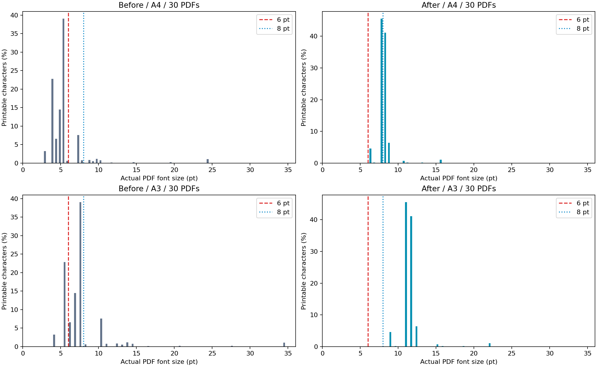
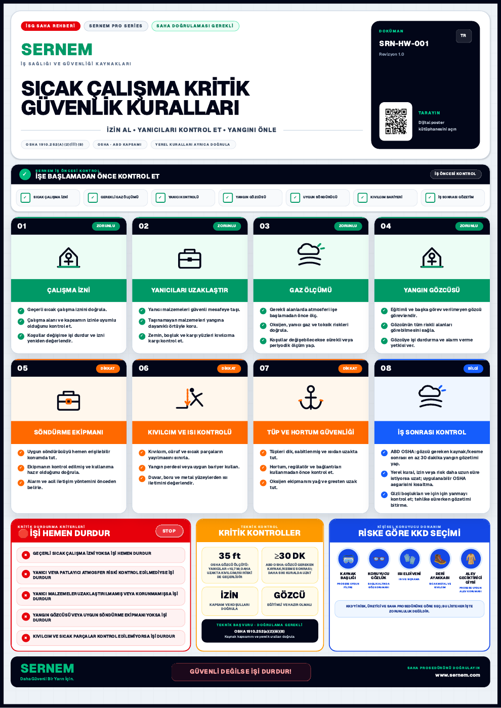
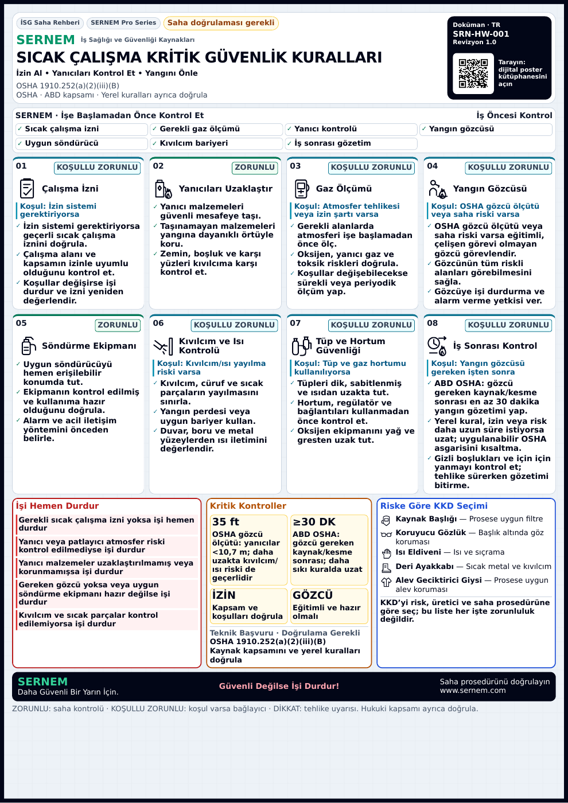

# Paket 13 — A4 okunabilirlik, ikon ve HSE etiket revizyonu

PR #126 / `codex/sernem-p13-hse-poster-quality`. Bu rapor önceki AUDIT ve ACCEPTANCE raporlarının yerleşim/ikon/font sonuçlarını günceller; önceki kaynak erişim engelleri devam eder. Uygulanan talimat: [yorum 6414234906](https://github.com/safebaseapp/safebase/pull/126#issuecomment-6414234906). Revizyon başlangıcı: `22ea88612ed920b72d9122bec13cbb3ead53c8c9`. Yeni dal/PR açılmadı.

## Karar

**Yazılım/font kalite kapısı: GO — Draft incelemesine hazır. Production teknik kabulü: NO-GO.** Resmî mevzuatın güncel metninin bağımsız doğrulanması ve yetkin HSE/yerel uygulanabilirlik kabulü henüz tamamlanmadı. Önceki kaynak istekleri 403 ile engellendi; bu revizyon taze resmî kaynak doğrulaması iddiasında bulunmaz. Fiziksel A4/A3 yazıcı çıktısı, gerçek müşteri Premium hesabı/depolaması ve uzaktan Preview E2E testi NOT TESTED. Yayın veya merge yapılmadı. Exact-SHA Preview durumu PR takip yorumunda ayrıca raporlanır; READY uzaktan E2E anlamına gelmez.

## Gerçek hata ve çözüm

Eski A3 tabanındaki 108px ikon boşluğu ve 11px kart gövdesi A4'e küçülünce okunamıyordu. Repo'daki önceki TR sıcak çalışma A4 PDF'sinde **3.321 yazdırılabilir karakterin %87,99'u 6pt altındaydı**, ağırlıklı ortalama **5,367pt**. Boşluklar hariç 2.878 karakter ve %87,49 ölçülür. Kullanıcının 3.004 karakterli dosyası ayrıca sağlanmadığından aynı dosya olduğu iddia edilmez; repo örneğinin SHA256'sı ve sayım yöntemi [before-fonts.json](readability/before-fonts.json) içinde. %88 bulgusu yeniden üretildi.

Kart ikonu 48px ile başlığın yanına alındı; kartlar, ön kontrol ve alt panellerde kullanılmayan alanlar yeniden dağıtıldı. Ön kontrol dört sütun/iki satır, KKD beş okunur satır oldu. Kart gövdesi 17px, kritik alt/koşul/kaynak yazıları 16px; **A4 gerçek PDF gövdesi minimum 8,294pt, kritik metin minimum 7,806pt**. En küçük belge metadatası **6,342pt**. A3 karşılıkları **11,730 / 11,040 / 8,970pt**. **60 PDF'nin tamamında 6pt altı karakter sıfır; tümü tek sayfa.**

A3 tuval, mevcut A4 küçültme oranı, sayfa boyutları ve QR adresleri korundu. Yazıyı küçülterek sığdırma veya zorunlu içeriği kaldırma yapılmadı. Root kırpması kaldırıldı; her metin aralığı hem kendi kart/paneline hem sayfa sınırına karşı kontrol edilir. En dar standart çıktıdaki alt boşluk 25,26 CSS px. İlk statik-font denemesinde 12 baskı görünümü taşma testinde FAIL oldu; boşluklar azaltılıp tüm matris tekrar çalıştırıldı. Bu başarısız ara sonuçlar son PASS yerine sunulmaz.

Mevcut yerel DejaVu Sans regular/bold fontları kullanıldı; font dosyaları değişmedi. Chromium'un değişken Geist fontunda görünür glif yolları ve Type3 erişilebilir metin üretmesi, katı görünür metin kontrolünü geçmedi. Test gevşetilmedi: statik fontla PDF metinleri gerçek, opak font span'leri oldu. Görünmez metin katmanı, şeffaf metin veya saklı içeriğe başvurulmadı.

## 120 ikon ve etiket

[Denetlenebilir tüm kartlar](readability/semantic-audit.json): **19 yanlış eşleşme düzeltildi, 100 doğru SVG geometrisi korundu, 1 tekrarlanan küçük 4:1 SVG yazısı kaldırıldı**; 4:1 teknik içeriği görünür metin ve teknik panelde korundu.

- Sıcak çalışma: sekiz kartın tamamı; izin belgesi, yanıcı malzeme, gaz dedektörü, yangın gözcüsü, söndürücü, kıvılcım bariyeri, gaz tüpü/hortum ve saatli iş sonrası gözetim.
- Yüksekte çalışma: plan, ankraj plakası/D halkası, düşüş açıklığı, bağlı el aleti, kurtarma — beş düzeltme.
- İskele: kontrol, etiket/durum, temel, platform, yük ve baş üstü tehlike — altı düzeltme. Sonuncusu mevcut doğru sembolü yeniden kullanır.
- Diğer on iki posterin doğru konu ikonları korundu. Beş konuya özel SVG renderer'ın gerçek çıktısı da denetlendi; yalnız ham `icon` alanına bakılmadı.

18 yeni ikon kodu açık TypeScript literal union ile tanımlı. Her kart ikonu yerelleştirilmiş TR/EN `role=img` / `aria-label` taşır. [Geometri öncesi/sonrası SHA256 ve kart bazlı gerekçe](readability/semantic-audit.json).

120 kartın uygulanabilirliği açık veri: **74 zorunlu saha kontrolü, 42 koşullu zorunlu kontrol, 4 tehlike uyarısı**. Yalnız bilgi veren kart bulunmadığı için **BİLGİ/INFO sayısı 0**; zorunlu emirler isteğe bağlı bilgi gibi etiketlenmez. Koşullu kartta koşul açıkça görünür. Zorunlu etiketi evrensel hukuk onayı değildir; bu ayrım alt açıklamada yazılıdır.

Sıcak çalışmada izin, gaz ölçümü, yangın gözetimi ve tüp kullanımı ilgili tehlike/izin/OSHA kriterleriyle koşullandırıldı. Yangın gözetimi gerektiğinde **en az 30 dakika**, **35ft (10,7m)** kapsamı ve daha uzun yerel/risk gözetimi değişmedi. Ankraj **5.000lb (22,2kN) / nitelikli kişi gözetiminde en az 2 güvenlik katsayılı bütün sistem** alternatifi ve diğer önceki OSHA asgarileri korunur. Beş iş durdurma maddesi her posterde korunur; gereken izin/gözetim/korumanın yokluğu koşullu ekipman seçiminden ayrılır. Yanlış EN varsayılanları ve Verified rozeti geri gelmedi. [32 sayısal/kapsam regresyonu](readability/mandatory-content-results.json).

## Kanıtlar

[60 PDF nokta ölçüm tablosu](readability/FONT-MEASUREMENTS.md) · [önce dağılımlar](readability/before-distributions.json) · [sonra dağılımlar](readability/after-fonts.json).



| Önce — TR sıcak çalışma A4 | Sonra — aynı konu/dil/boyut |
|---|---|
|  |  |

TR ve EN tüm 15 konu için `readability/before-{tr,en}-*.png` ve `after-{tr,en}-*.png` dosyaları gerçek PDF rasterleridir. [TR 15 poster görünümü](readability/after-tr-overview.jpg) · [EN 15 poster görünümü](readability/after-en-overview.jpg).

Gerçek PDF örnekleri: [TR sıcak çalışma A4](readability/sample-tr-hot-work-a4.pdf), [EN sıcak çalışma A3](readability/sample-en-hot-work-a3.pdf), [TR yüksekte çalışma A3](readability/sample-tr-height-a3.pdf), [EN yüksekte çalışma A4](readability/sample-en-height-a4.pdf). Tüm 60 dosyanın hash'i [pdf-results.json](readability/pdf-results.json) içinde; tam matris `/tmp/p13-readable/` altında yeniden üretilebilir.

## Son test kapısı

| Test | Sonuç | Kanıt / sınır |
|---|---|---|
| TypeScript `npx tsc --noEmit` | PASS | Normal build'in TypeScript adımı da başarılı |
| Değişen TS/TSX ESLint | PASS | 0 hata, mevcut QR/logo `` için 2 uyarı; başlangıçtaki 48 static-component hatası aynı SVG helper dışarı taşınarak giderildi |
| Normal `npm run build` | PASS | prebuild dahil; PDF polish, toolbox PDF QA ve download-flow QA çalıştı; üretilen ilgisiz download PDF değişiklikleri geri alındı |
| Mevcut içerik/koruma regresyonları | PASS | 36 kontrol; [content-results.json](readability/content-results.json) |
| Gerçek ikon geometrisi + etiket verisi | PASS | 120 kart, TR/EN etiket/koşullar; [semantic-audit.json](readability/semantic-audit.json) |
| TR/EN A4/A3 kırpılma/çakışma/tek sayfa | PASS | 60 gerçek rota, [browser-results.json](readability/browser-results.json) |
| TR/EN 320/360/390/1440 responsive | PASS | 120 görünüm + tarayıcı hata kapısı; toplam 181 kontrol |
| Gerçek PDF punto/boyut/opak metin | PASS | 60; gövde ≥8pt, kritik ≥7,5pt, hiçbir karakter <6pt |
| QR çözme/PDF metni/karakter ve sınırlar | PASS | 60 gerçek raster; fiziksel telefon kamerası testi değil |
| Önceki OSHA sayısal/kapsam regresyonu | PASS | 32; güncel resmî metnin bağımsız doğrulanması değil |
| Logolu şablon taşması | PASS | 15×TR/EN = 30; gerçek Master + maksimum 56px sentetik logo, A3 tuval/A4 orantılı ölçek; gerçek hesap E2E değil |
| Yazdır/PDF/logolu erişim davranışı | PASS | 13 fixture kontrolü: gerçek değiştirilmemiş toolbar/canvas + sentetik guest/free/Premium/admin/suspended/missing-logo; gerçek servisler NOT TESTED |
| PNG | NOT TESTED / mevcut eylem yok | Mevcut toolbar PNG sunmuyor; kapsam dışı yeni indirme eylemi eklenmedi |
| Fiziksel baskı ve uzaktan Preview E2E | NOT TESTED | Donanım/gerçek kullanıcı işlemi yapılmadı |
| Güncel resmî mevzuat ve uzman kabulü | NOT VERIFIED | [Önceki erişim engeli](acceptance/source-access.json); NO-GO sürer |

Yerel testte yalnız loopback Supabase fixture adresi kullanıldı; canlı servise erişilmedi. İstekler yerel GET dışına kapatıldı; fixture aktivite kayıtları yalnız belleğe yazıldı. Premium/izin/depolama davranışları değiştirilmedi.

## Değişen dosya grupları ve çakışma koruması

Aktif poster Header, PreJobStrip, BottomPanels, Footer, Master, RuleCard ve PosterIcon; yeni ortak CSS, TaskIcon/PpeSymbol; 15 poster veri tanımı ve icon/application tipleri. Test/raporlar yalnız `tools/p13-review` ve `docs/p13-review` altında. Archived renderer'lar, poster route/print geometrisi, branding canvas/toolbar ve beş konuya özel SVG renderer korunur.

[80 korunan dosyanın SHA256 kontrolü](readability/protection.json) PASS. Önceki 82'den yalnız bu yorumun açıkça değiştirilmesini istediği RuleCard ve PosterIcon istisna tutuldu; neden ve talimat bağlantısı manifestte kayıtlı. Auth, ödeme, entitlement, Supabase/schema/RLS, SIM/XP ve provider ayarları değişmedi. #122 ve başka paketlerden commit taşınmadı. Main/production ve gerçek müşteri verisine dokunulmadı. Aynı Draft PR #126 inceleme/onay bekler.

## Yeniden üretim

Repo kökünden, production build'in yerel sunucusu çalışırken:

```sh
P13_EVIDENCE_DIR=docs/p13-review/readability node tools/p13-review/content.mjs
node tools/p13-review/readability-audit.mjs
P13_URL=http://127.0.0.1:4223 node tools/p13-review/readability-browser.mjs
python3 tools/p13-review/measure-fonts.py /tmp/p13-readable docs/p13-review/readability/after-fonts.json
P13_PDF_DIR=/tmp/p13-readable P13_EVIDENCE_DIR=docs/p13-review/readability P13_BEFORE_PDF_DIR=/tmp/p13-acceptance python3 tools/p13-review/pdf.py
P13_PDF_DIR=/tmp/p13-readable P13_EVIDENCE_DIR=docs/p13-review/readability node tools/p13-review/acceptance.mjs
P13_URL=http://127.0.0.1:4223 P13_EVIDENCE_DIR=docs/p13-review/readability node tools/p13-review/actions.mjs
P13_URL=http://127.0.0.1:4223 node tools/p13-review/branded-layout.mjs
python3 tools/p13-review/font-report.py
```

Önceki PDF'ler hash eşleşmeli baseline kanıtlarıdır; `/tmp` arşivi yeni ortamda otomatik mevcut kabul edilmez. Tarayıcı Chromium/Playwright, PDF analizi PyMuPDF/Poppler, QR zbar ve grafikler matplotlib gerektirir.
