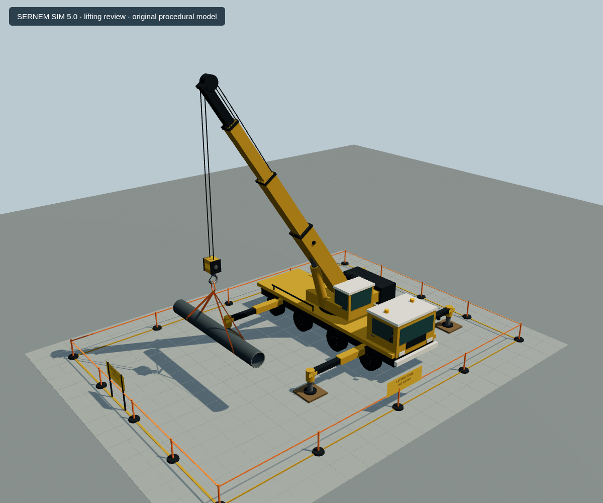
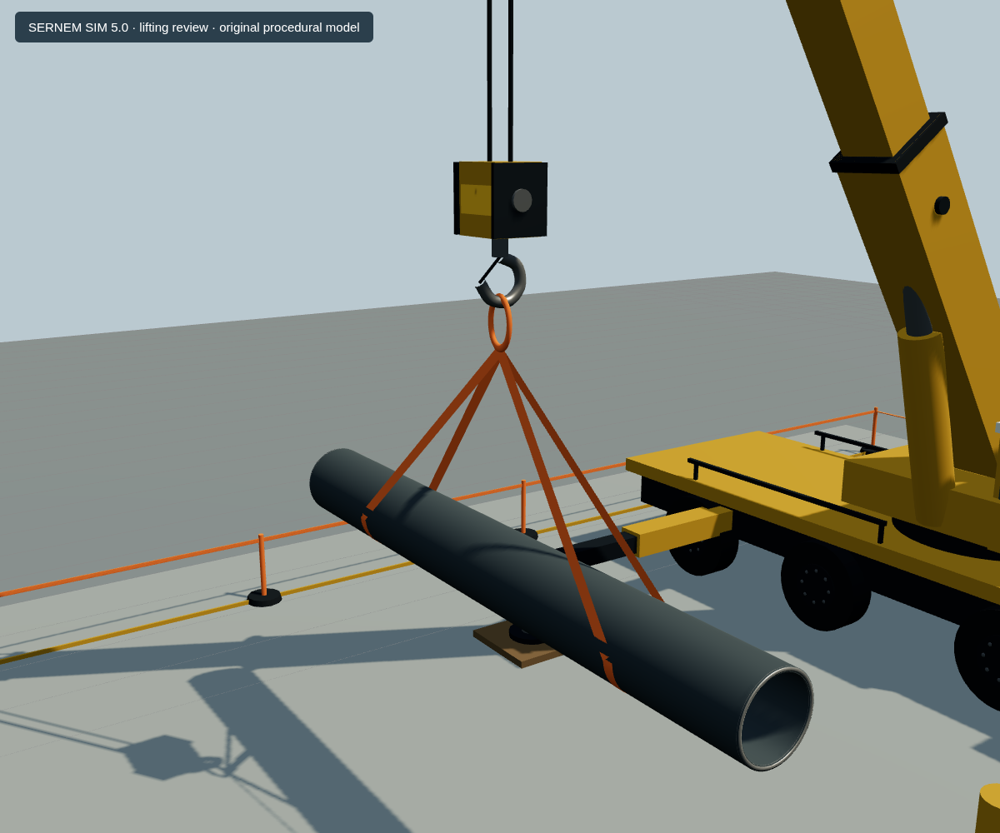
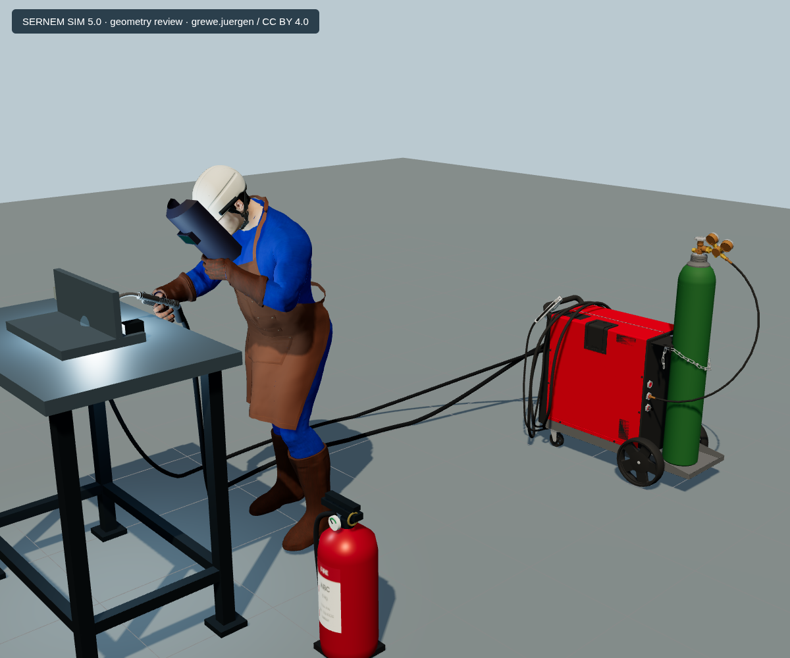

# SIM 5.0 — vinç kaldırma ve kaynakçı materyal paketi

Başlangıç dalı: `codex/sim5-welding-geometry-fix`,
`18c86b8e63393807c860ed54b45a96134f5689c4`.
Yeni dal: `codex/sim5-lifting-and-welder-color-pack`.
Hedef geliştirme dalı: `feature/sernem-sim5-professional-site-package2-20261017`.
Bu paket bir yeni commit ekler; hedef dal önceki kaynak düzeltmesini henüz
almadığı için PR önceki geometri commit'ini de içerir.

## Analiz ve uygulama

Kaynakçının dokuları GLB içinde mevcut. Deri önlüğün roughness değeri yaklaşık
0,246; baretinki yaklaşık 0,283 idi. Güçlü saha ışığında bu yüzeyler beyaz
parlamalara açıktı. Baretin normal verisi pozlanmış olmasına rağmen orijinal
tangent çerçevesi korunuyordu; normal haritası ile yeni pozun uyumu da düzeltildi.

`WeldingOperation.ts` özgün albedo/UV dokularını korur; mavi tulum, kahverengi
deri ve eldiven/çizme, açık baret için kontrollü renk çarpanları ve metalik
olmayan roughness ayarları uygular. Dokusu bulunmayan materyal için aynı parça
renginde fallback vardır. Koyu siper filtresi korunur. Kaynak ışığı ve çekirdeği
büyütülür; küçük bir mavi halo ve daha okunur parçacıklar eklenir. Torç, tel,
masa, el, siper ve kablo referansları önceki raporla 1e-9 m toleransında aynı
kalır. Vücut pozuna veya GLB geometrisine yeni bir değişiklik uygulanmaz.

Repoda kullanılabilir vinç GLB'si yoktu. `LiftingOperation.ts` özgün bir
prosedürel mobil vinç oluşturur: sekiz lastik, iki kabin, teleskopik bom,
hidrolik silindir, karşı ağırlık, dört açık denge ayağı ve zemin matı; tambur,
bom başı makarası, çift hoist halatı, kanca bloğu, kapanan mandal ve ana halka.
Halat makaranın merkezinden geçirilmez; dışına teğet dönüşle bağlanır.

6 m uzunluğunda, 0,68 m dış çapında açık uçlu çelik boru iki simetrik sepet
sapanla taşınır. Sapanlar borunun altını kavrar; yükün iki yanındaki pick
istasyonları ±1,8 m'dir. Düşey halatlar ve yük merkezi aynı yatay koordinatı
paylaşır. Kaldırma pozu statik ve dengelidir; yük salınımı, elastik uzama veya
sertifikalı kapasite hesabı modellenmez.

## Yerleşim ve eğitim etkileşimi

Vinç grubu saha koordinatında **(−30; 0,06; 47)** konumundadır. Yeni beton
pad, fabrikanın mevcut zemin izinin önünde yer alır; ana yol ve yaya kaldırımı
ile kesişmez. Pad kalınlığı çim zemine gömülür; vinç ve ayaklar havada bırakılmaz.
Boru altı yaklaşık 2,26 m yerel yükseklikte, saha yüzeyinden açıktadır.
Denge ayakları ve boru, turuncu bariyerli ve TR/EN levhalı güvenlik alanının
içindedir. İşaretli erişim yolunun sonunda dışarıdan inceleme yapılabilir.

Mevcut üç HSE sorusu korunur. Yeni kaldırma sorusu, askıdaki yükün altından
geçmeyi reddeder ve alan dışında işaretçi onayını beklemeyi doğru kabul eder.
Sayaç sabit 3 yerine senaryo sayısını kullanır. Her iki dilde güvensiz seçim,
doğru seçim, tekrar incelemede mükerrer puan almama ve dört senaryonun birlikte
4/4 tamamlanması test edilir.

## Test ve render kanıtları

Tekrarlama: [test aracı](../../tools/sim5-review/README.md).
Tarayıcı: Chromium / SwiftShader, gerçek Three.js WebGL render'ı.
Test fixture'ları gerçek uygulama modüllerini ve tam `RealModels` bileşenini
kullanır; Supabase veya production erişimine ihtiyaç duymaz.

- 28 kaynak / tesis / mevcut HSE regresyon kontrolü.
- 47 ek renk, geometri koruma, kaldırma bağlantısı, yerleşim ve TR/EN kontrolü.
- TypeScript ve iki operasyon modülünün ESLint kontrolü.
- Üç farklı vinç açısı, rigging ve makara yakın planı; üç kaynakçı açısı ve
  kaynak teması yakın planı; gerçek tesis içinde TR/EN yaklaşma/arka/genel görünüm.

Tüm site için temiz bir ESLint veya production Next build sonucu iddia edilmez;
mevcut lint borcu ve ayrı tutulan Google Fonts konusu bu paketin dışındadır.
Supabase'e bağlı kimlik doğrulama akışları ve production üzerinde test yapılmadı.
Font fallback dosyaları, uygulama bağımlılıkları ve diğer simülasyonlar değişmedi.

## Lisans

Yeni vinç, sapan, kanca, boru ve levha geometrileri özgün proje üretimidir ve
[deponun MIT lisansı](../../LICENSE) kapsamındadır. Dışarıdan model indirilmedi.
Kaynakçı, fabrika ve tank GLB'leri byte düzeyinde korunur. Kaynakçının
[grewe.juergen / CC BY 4.0 atfı](../sim5-welding-review/README.md#lisans-ve-atıf)
ve mevcut tesis yazarlarının arayüz atıfları korunur.

Son doğrulama: **75 kontrol geçti** (28 regresyon + 47 ek kontrol); iki
çalışmada da tarayıcı hatası ve harici ağ isteği sıfırdı. TypeScript ve yeni iki
operasyon modülünün ESLint komutları exit 0 ile tamamlandı.

Sayısal sonuçlar: [kaynak regresyonu](welding-regression-results.json),
[ek paket testleri ve materyal örnekleri](pack-results.json).

### İncelenen gerçek render'lar

- Vinç: [ön](pack-lifting-front.png), [arka](pack-lifting-rear.png),
  [yol tarafından](pack-lifting-road-side.png).
- Bağlantılar: [kanca, sapan ve boru](pack-lifting-rigging.png),
  [bom başı halat dönüşü](pack-lifting-head-reeving.png).
- Kaynakçı: [açı 1](pack-welder-1.png), [açı 2](pack-welder-2.png),
  [açı 3](pack-welder-3.png), [belirginleşen ark ve temas](pack-weld-contact.png).
- Gerçek tesis: [TR yaklaşma ve HSE 4/4](pack-site-tr-approach.png),
  [TR arka açı](pack-site-tr-rear.png), [EN genel saha](pack-site-en-overview.png).

