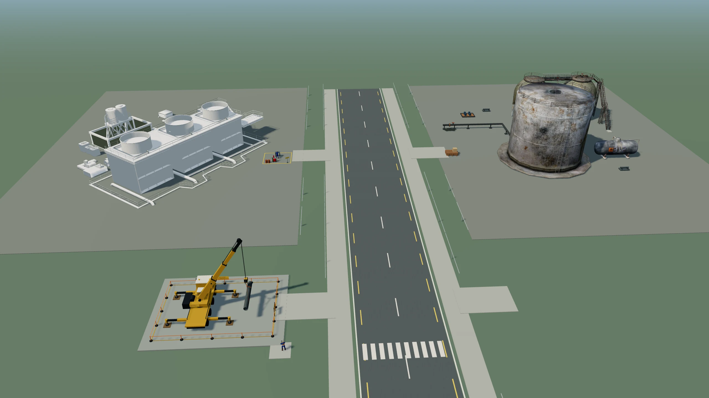
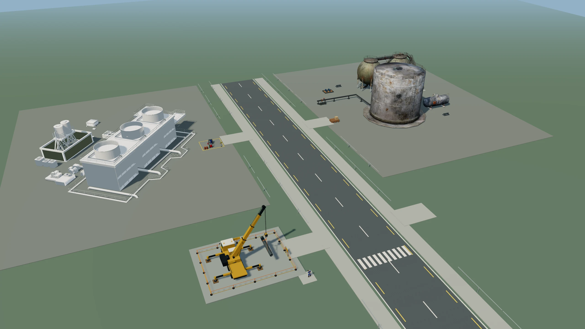
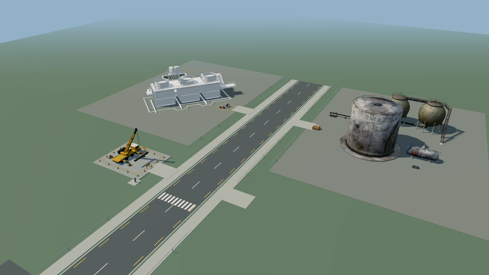
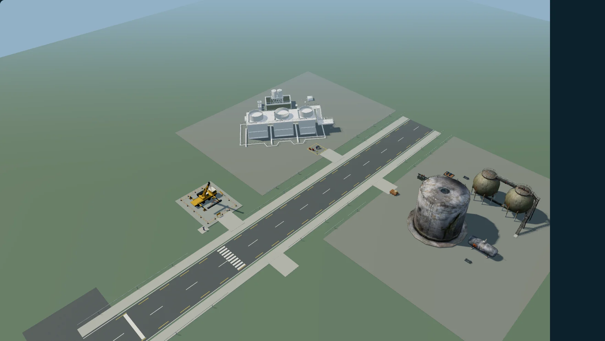

# SERNEM SIM 5.0 — Paket 9

Başlangıç: PR #106, `codex/sim5-final-homepage-menu-visual-xp-pack8`, `0742757f2dfb78006671f46221e8b082c5115125`.
Yeni dal: `codex/sim5-showcase-image-refresh-pack9`.

## Gerçek neden ve model kanıtı

Ayrı bir “yeni beyaz tank GLB” bulunmadı ve üretilmedi. `RealModels.tsx` fabrika modelini x=-47, tank sahası modelini x=47 konumunda yüklüyor. Eski çekim betiği de aynı çalışan sahneyi kullanıyordu. Tank GLB’sinin Git nesnesi Paket 6 (`9cc0d0d`), Paket 6 + Labs (`9c7bb81`) ve Paket 8 (`0742757`) sürümlerinde aynı: `37aaa996a26fbc04a6265be3934c1ae5bd5290c7`. Tank dosyasının SHA-256 değeri de Paket 8 çekim kaydıyla aynı: `57f8af41a804fb9f231437c73c5fcd1d11047a4aac42aaa43f0b52dd8d3558e8`.

Yüksek eski kamera, ayrı depolama sahasının koyu/paslı çatısını öne çıkarıyordu. Daha alçak kamera, tankın yan yüzeyini daha fazla gösteriyor; **özgün dokuda gövde üzerinde de pas/patina var**, bu nedenle temiz beyaz tank gibi sunulmuyor veya boyanmıyor.

Seçilen karede fabrikanın üzerindeki beyaz silindirik parçalar **`SERNEM_SIM4_Factory_optimized.glb`** içindedir. Fotoğraftaki üç beyaz silindire ışın gönderildi; çarpılan `Object_4` / `Object_14` adlarının orijinal fabrika GLB’sinde bulunduğu ve kök model merkezinin x=-47 olduğu doğrulandı. [Işın/mesh kanıtı](results/white-cylinder-source.json), [kaynak denetimi](source-audit.json), [yüklenen üç GLB’nin SHA-256 ve kamera kayıtları](capture-provenance.json).

Kullanıcının verdiği iki eski Preview ve PR #106 Preview’ına doğrudan erişim, bu bulutun ağ geçidinde `CONNECT 403` ile engellendi. Bu yüzden uzaktaki tarayıcı görüntüsü veya Vercel CDN içeriği doğrulanmış gibi raporlanmıyor. Model eşitliği Git kaynakları, gerçek yerel WebGL sahnesi, GLB yanıt hash’leri ve mesh ışınları üzerinden kanıtlandı.

## Üç gerçek açı

Üçü de mevcut `RealModels` sahnesi, özgün ışıklar/malzemeler ve GLB’lerle, yalnız test kamerası klonlanarak çekildi. Oyun kamerası, sahne, geometri, GLB’ler ve XP kodu değişmedi. Görüntüler 2560×1440, 16:9 WebP; stok veya yapay görüntü kullanılmadı.

| Güney | Güneybatı — seçilen | Güneydoğu |
|---|---|---|
|  |  |  |

Güneybatı seçildi: vinç ve askıdaki yük ön planda daha büyük, fabrikanın beyaz silindirleri okunabilir, yol ve özgün tank sahası aynı karede; gökyüzü/boş zemin azaltıldı. Diğer iki açı inceleme için korunuyor.

| Paket 8 önce | Paket 9 seçilen |
|---|---|
|  |  |

Yeni ortak dosya: `app/public/images/sim5-site-showcase.webp`, **2560×1440, 132.642 bayt**.
SHA-256: `8c8ea3942ce6eba9ed9fae5273839530d5523f572e26fdb4a7b892a01d14086b`.

## Uygulama ve önbellek

Homepage, Labs ve Platform/HSE Labs menüsü `app/components/sim5/showcase-image.ts` üzerinden **tek static import** kullanıyor. Next bu içerik için `/_next/static/media/sim5-site-showcase.2m4gwlpialk6s.webp` üretti; yeni dosya baytları yeni kaynak/optimizer cache anahtarı oluşturur. Aynı URL üzerinde eski optimize görüntüye güvenilmiyor.

93 kontrol, TR/EN × 320/390/820/1600 px üzerinde üç alandaki hash’li kaynak dosyanın baytlarını yeni WebP ile karşılaştırdı. Hepsi tek kaynak kullanıyor. Eski public dosya adresi de yeni baytları döndürüyor. Next optimizer’a WebP Accept başlığıyla yapılan iki istekte HTTP 200, cache HIT ve aynı yeni çıktı hash’i görüldü. İlk test betiği WebP Accept başlığı göndermediğinden format varsayımı başarısız olmuştu; tarayıcının format pazarlığını açıkça taklit edecek şekilde düzeltildi ve 93 kontrol yeniden geçti. [Sonuçlar](results/cache-results.json).

Canlı Vercel edge CDN içeriği, ağ erişimi engeli nedeniyle ayrıca test edilemedi. Hash’li static import ve yerel optimizer doğrulaması edge testi olarak sunulmuyor. Eski görsel yalnız bu tarihsel karşılaştırma kanıtında tutulur; etkin üç tanıtım alanının kaynakları yeni görseldir.

Homepage tüm viewport’larda 16:9 rezerv alanı ve `object-fit: contain` kullanıyor; mobilde 4:3 crop kaldırıldı. Labs da `contain` kullanır. Bu, vinç veya tankların kenardan kırpılmasını önler; CTA’lar ve TR/EN içerik/bağlantılar korunur.

| Ekran | Masaüstü | Mobil |
|---|---|---|
| Homepage TR | [görsel](renders/home-tr-1600.webp) | [görsel](renders/home-tr-390.webp) |
| Homepage EN | [görsel](renders/home-en-1600.webp) | [görsel](renders/home-en-390.webp) |
| Labs TR | [görsel](renders/labs-tr-1600.webp) | [görsel](renders/labs-tr-390.webp) |
| Labs EN | [görsel](renders/labs-en-1600.webp) | [görsel](renders/labs-en-390.webp) |
| Menü TR | [görsel](renders/menu-tr-1600.webp) | [görsel](renders/menu-tr-390.webp) |
| Menü EN | [görsel](renders/menu-en-1600.webp) | [görsel](renders/menu-en-390.webp) |

Ekran görüntüleri gerçek yerel Next production build’den, fiziksel cihaz veya Vercel tarayıcısından değil.

## Bu pakette yeniden çalıştırılan testler

| Kontrol | Sonuç |
|---|---|
| Homepage/Labs/menü, TR/EN, 6 responsive boyut, Tab/Escape/focus, CTA gerçek navigasyonu | **125 geçti** — [log](results/sim9-showcase.log) |
| Ortak yeni kaynak, hash/bayt, 16:9, crop yok, CTA görünür, taşma yok, optimizer cache | **93 geçti** — [JSON](results/cache-results.json) |
| Beyaz silindirlerin gerçek GLB kaynağı | **3 ışın eşleşmesi geçti** — [JSON](results/white-cylinder-source.json) |
| DEMO allowlist, iki bulgu, sıfır kalıcı XP, sınırsız replay | **Geçti** — [log](results/sim9-demo.log) |
| Sunucu Premium/Admin/Free/expired/suspended/guest/fail-closed erişim fixture’ları | **Geçti** — [log](results/sim9-access.log) |
| Sunucu altı bulgu replay/skor/XP doğrulaması | **18 geçti** — [log](results/sim9-replay.log) |
| Gerçek API handler fixture’ları, yetki/sahiplik/çakışma | **12 geçti** — [log](results/sim9-api.log) |
| Login/Premium yönlendirmeleri | **20 geçti** — [log](results/sim9-redirect.log) |
| Görev state ve sonuç raporu | **27 geçti** — [log](results/sim9-mission-state.log) |
| Altı bulgu tamamlama, retry, partial kayıt, gerçek istemci persistence ile fixture API | **6 geçti** — [log](results/sim9-persistence-browser.log) |
| İki kez DEMO tamamlama/dil, render azaltma, replay, zorlanmış WebGL kaybında rapor korunması, sıfır DEMO yazımı | **13 geçti** — [log](results/sim9-webgl.log) |
| Geçici PostgreSQL 17 migration/RLS/owner/duplicate/concurrency/best-XP/progress/level | **20 geçti** — [log](results/sim9-db.log) |
| Showcase/CTA analitik kodu, StrictMode/rerender | **Geçti**, gerçek GA4 collector değil — [log](results/sim9-analytics.log) |
| TypeScript | **Geçti** — [log](results/sim9-tsc.log) |
| Değişen uygulama dosyalarında ESLint | **0 hata, mevcut Labs img için 1 uyarı** — [log](results/sim9-lint.log) |
| Next production build | **Geçti**, 848 sayfa — [log](results/sim9-build.log) |

`RealModels`, SIM mission/report/replay/entitlement/history/XP/API kodu, Supabase migration’ları ve `public/sim5` modellerinde başlangıca göre **sıfır diff** var. DEMO iki bulgu ve kalıcı XP’siz; Premium/Admin altı bulgulu ve sunucu kontrollü; statik görevde yalnız en iyi puan artışı, en fazla 200 kalıcı XP davranışı korunuyor. Sonuç şeması değişmedi. Test SQL’i yalnız `--network none` ile açılan geçici PostgreSQL konteynerinde çalıştırıldı; test sonunda konteyner kaldırıldı.

**CANLI SUPABASE, CANLI GA4 COLLECTOR VE FİZİKSEL CİHAZ TEST EDİLMEDİ.** Production bağlantısı, migration, gerçek profil/XP yazımı yok. Üretim SIM tabloları kurulmadığından canlı kalıcı XP hazır/doğrulanmış değildir. Paket 8’de belgelenen depo geneli ESLint hataları bu görsel paketi kapsamında düzeltilmedi veya başarılı ilan edilmedi. Eski Preview’ların doğrudan görsel/CDN incelemesi ağ geçidi nedeniyle engellendi.

Main/production’a dokunulmadı; PR #106 değiştirilmedi; merge veya production yayını yapılmadı. Draft PR açıklamasında son SHA ve Vercel durumu yer alır.

## Tekrar üretme

`node tools/sim5-review/capture-showcase-pack9.mjs` üç açıyı `tools/sim5-review/artifacts/pack9` altına üretir; seçilen `southwest.webp` ortak public WebP’ye kopyalanır. `node tools/sim5-review/showcase-source-test.mjs` GLB mesh eşleşmelerini doğrular. Next production build ve yerel sunucudan sonra `SIM5_NEXT_URL=http://127.0.0.1:<port> node tools/sim5-review/showcase-cache-test.mjs` ve `showcase-browser-test.mjs` çalıştırılır. Yerel DB testi yalnız disposable `sim5-pack7-db` konteyneriyle `database-test.mjs` üzerinden çalıştırılır; production’a yönlendirilmez.
